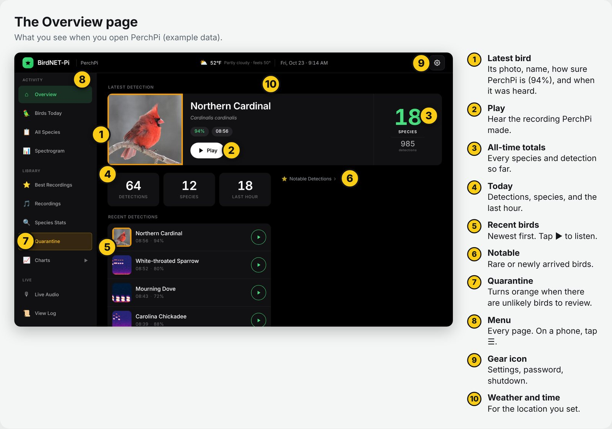
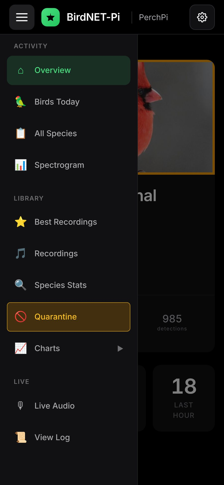
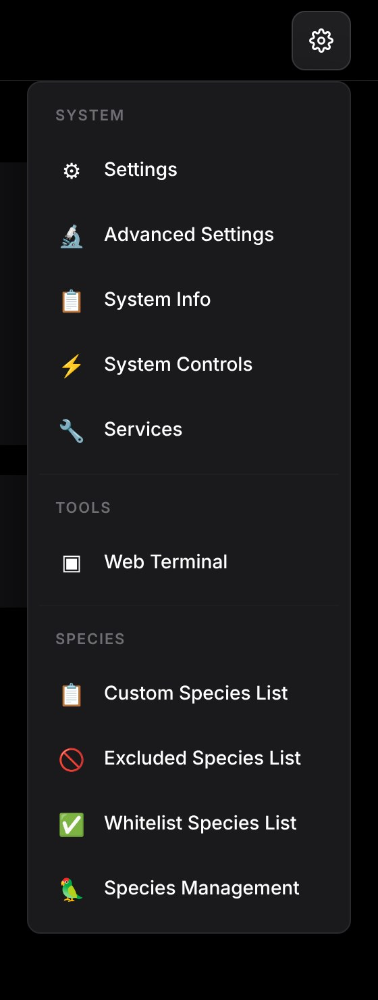
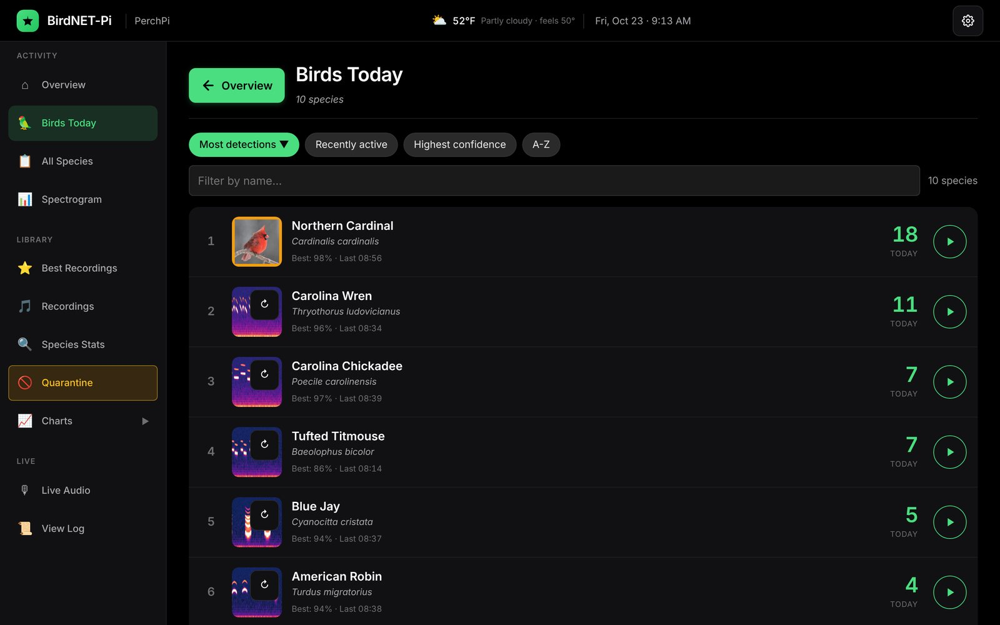
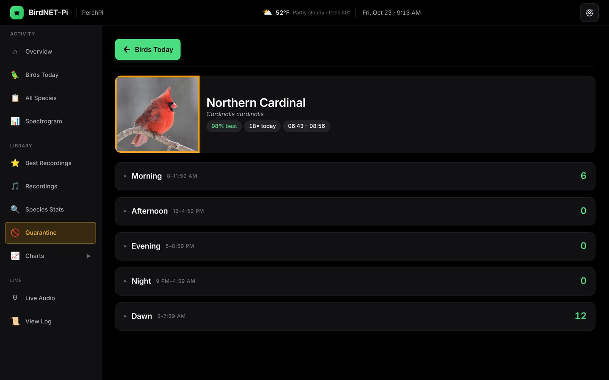
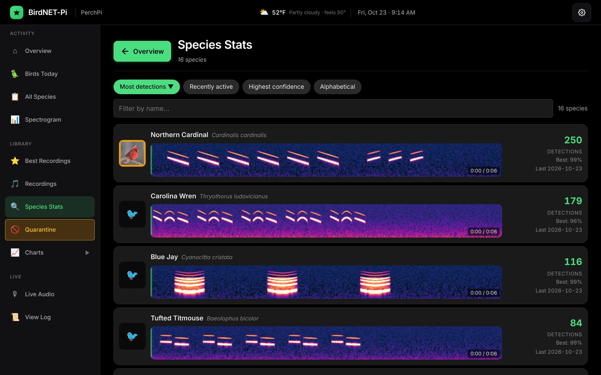
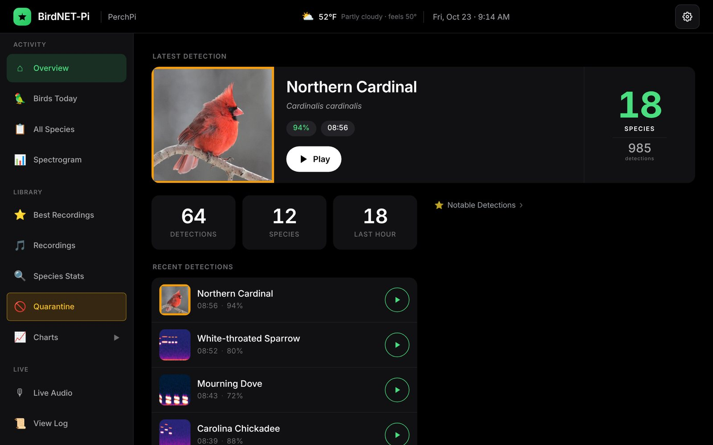
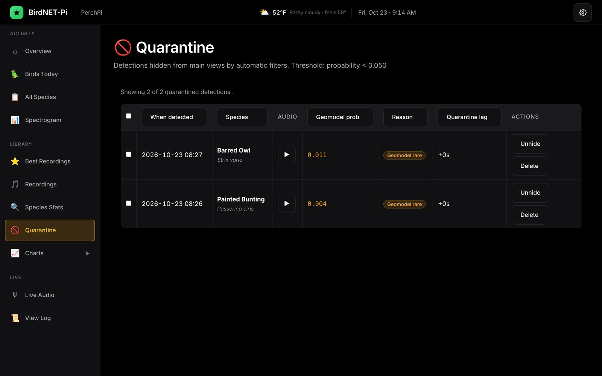
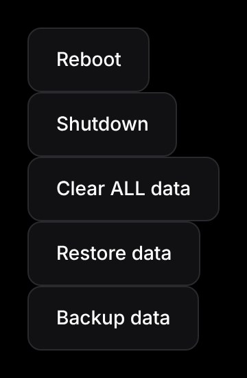

# PerchPi User Manual

This manual covers everyday use once PerchPi is running. To set it up for the first time, start with the **PerchPi Setup Guide**:
https://github.com/churchja/perchpi-release/blob/main/docs/SETUP-GUIDE.md

Questions or problems? Email **perchpi@shadyacres.my**.

Comfortable with SSH? The [Technical reference](#technical-reference-for-raspberry-pi-hobbyists) at the end lists PerchPi's services, files and logs.

**Prefer paper?** The illustrated, printable guide: [PerchPi-Guide.pdf](https://github.com/churchja/perchpi-release/blob/main/docs/PerchPi-Guide.pdf)


## How PerchPi works, in one minute

- The microphone records continuously, in 15-second pieces.
- Each piece is checked by two bird-identification programs: BirdNET from the Cornell Lab of Ornithology, and Google's Perch.
- When a bird is identified with enough confidence, PerchPi saves a **detection**: the species, the time, a confidence score, and the audio clip with a picture of the sound (a spectrogram).
- PerchPi also knows which birds are likely where you live in each week of the year. A bird that is very unlikely for your place and season goes into **Quarantine** for you to review, instead of into your lists.
- **Your recordings stay on the Pi.** PerchPi does go online to fetch bird photos (from Wikipedia) and the weather for your location. It shares detections only if you turn on BirdWeather or notifications.


## Opening PerchPi



On any phone, tablet, or computer on the same Wi-Fi as the station, open a web browser and go to `http://<your-hostname>.local/`, for example `http://perchpi.local/`. The page title says BirdNET-Pi; that's normal.

Tip: on a phone, add the page to your home screen so it opens like an app.

Most pages ask for the **web login** the first time you open them, and your browser remembers it. The username is `birdnet`. The password is the web password you chose in the Setup Guide, section 8, or `birdnet` if you never changed it. It is **not** the login you typed in Raspberry Pi Imager.


## The menu

The menu runs down the left side. On a phone, tap the menu button (three lines) at the top left to open it.

 

### Activity
- **Overview:** the home page. It shows the latest bird, today's totals, and recent detections. Tap a bird to hear it.
- **Birds Today:** every species heard today, with counts and times.
- **All Species:** every species the station has ever heard.
- **Spectrogram:** a live picture of what the microphone hears right now. Bird songs show up as marks and streaks.


*Birds Today: every species heard today (example data).*


*Tap any bird for its detections by time of day.*

### Library
- **Best Recordings:** the clearest recording of each species.
- **Recordings:** every saved recording, by date and species.
- **Species Stats:** per-species counts, first and last heard, and activity over time.
- **Quarantine:** detections held back because the bird is unlikely for your place and time of year. See "Reviewing Quarantine" below.


*Species Stats: each species with its best recording's spectrogram. The bright marks are the song.*

### Charts
- **Daily Charts:** when each species was active through the day.
- **Weekly Report:** a summary of the past week.
- **Detection Patterns:** interactive charts to explore your data.

### Live
- **Live Audio:** listen to the microphone live, about 6 seconds behind. This is the quickest way to check the microphone works.
- **View Log:** the station's technical log, useful if something is wrong.

### The gear menu (top right)
- **Settings:** location, BirdWeather, notifications, bird-name language, time zone.
- **Advanced Settings:** the web password, storage, audio, and detection settings.
- **System Info:** temperature, memory, and disk space.
- **System Controls:** Reboot, Shutdown, Backup data, and Restore data. **Never press Clear ALL data**: it erases every detection and recording, and can't be undone.
- **Services:** the status of PerchPi's background programs.
- **Web Terminal:** turned off in PerchPi v1. Ignore it.
- **Custom Species List / Excluded Species List / Whitelist Species List / Species Management:** lists for fine-tuning which species are reported.

On the settings pages, **scroll down** to the section you want, and click **Update Settings** at the bottom of the page to save.


## The touchscreen



With a screen attached, PerchPi shows the Overview full-screen from the moment it starts. Tap a bird to see it and play its song. The touchscreen is for watching and listening; use a phone or computer to change settings.


## Reviewing Quarantine

PerchPi quarantines detections of birds that are very unlikely at your location in the current week. Most are mistakes, for example a similar-sounding bird or a noise. Some are real rarities.



Open **Quarantine**, play the recording, and decide:
- **Unhide** if it really is that bird. It moves into your normal lists.
- **Delete** if it's wrong. This can't be undone.

Quarantine only works well once your **location is set** (gear → Settings → Location).


## Settings you might want

All of these are under the gear icon. Scroll to the section, change it, and click **Update Settings**.

- **Location** (Settings → Location): latitude and longitude, at most 4 digits after the decimal point. Set this first; it improves accuracy a lot.
- **Site Name** (Settings → Location): the name shown in the browser tab.
- **Web password** (Advanced Settings → BirdNET-Pi Password): letters and numbers only. Delete the old one from the box before typing the new one.
- **BirdWeather** (Settings → BirdWeather): share detections with the BirdWeather community map. You need a free station token from https://www.birdweather.com/.
- **Notifications** (Settings → Notifications): get a message on your phone or by email for new species, the first detection of each species each day, or every detection. PerchPi uses Apprise, which supports email, Telegram, Pushover, ntfy, and many more. **Send Test Notification** checks that it works.
- **Bird-name language** (Settings → Localization → Database Language).
- **Time zone** (Settings → Time and Date).

Leave the detection settings in **Advanced Settings** (Minimum Confidence, Sigmoid Sensitivity, Overlap) at their defaults unless you know why you're changing them. They're tuned for the recommended microphone.


## Storage: what is kept, and for how long

- The **list of detections** (species, time, confidence) is kept indefinitely.
- **Audio clips** are kept for **45 days**. After that, PerchPi deletes old clips but always keeps the **5 best recordings of every species**.
- If the card gets nearly full, PerchPi deletes the oldest unprotected clips early, to keep at least 15% of the card free.
- Gear → **System Info** shows how full the card is.

A 64 GB or larger card gives plenty of room. You can change the 45 days under gear → Advanced Settings → **PerchPi Retention**.


## Turning PerchPi off and on



- **Never just pull the plug while it's running.** That can damage the memory card.
- **To turn it off:** gear → **System Controls** → **Shutdown**. Wait about 30 seconds, until the light on the Pi stops blinking green, then unplug it.
- **To turn it back on:** plug the power back in. It starts by itself.
- **To restart:** gear → **System Controls** → **Reboot**.

After a power cut, PerchPi starts again by itself when the power returns.


## Backing up

Gear → **System Controls** → **Backup data** downloads one file to your phone or computer. It contains your **detection database, recordings, notification setup, and species lists**. With many recordings it can be several gigabytes and take a long time, so use a computer rather than a phone.

**Write down your settings too.** In PerchPi v1, the backup does **not** include the choices on the Settings and Advanced Settings pages: location, web password, site name, BirdWeather token, retention days. Keep a note of them.

**Restore data has a known problem in v1** that can leave the station with mixed-up settings. Please email **perchpi@shadyacres.my** before using it.


## Updating PerchPi

PerchPi v1 has no update button. Updating means writing a newer version onto the memory card with Raspberry Pi Imager, which replaces everything on the card. When a new version comes out, its release notes will explain how to keep your data. New versions are listed here:
https://github.com/churchja/perchpi-release/releases


## Troubleshooting

- **The page won't open.** Check that the Pi has power and your phone or computer is on the same Wi-Fi. Wait 5 minutes after a restart. If `.local` doesn't work on your device, use the Pi's number address from your router's device list, for example `http://192.168.1.57/`.
- **The page keeps asking for a password.** Use the **web** login (`birdnet` and your web password), not the one you typed in Imager.
- **No new birds.** Open **Live Audio**. Silence means a microphone problem: check that the microphone is in the **red** jack of the UGREEN adapter, then gear → System Controls → Reboot. If you hear sound but get no birds, check your location setting and give it a busy morning. Birds are most active in the first hours after sunrise.
- **Many wrong birds.** Set your location. Move the microphone away from noise. Review Quarantine.
- **A bird you heard is missing.** Look in **Quarantine**.
- **The screen is black.** Plug the screen in before powering the Pi, then Reboot.
- **Forgot the web password.** Email for help (below).
- **The card is full.** Check gear → System Info. Lower the retention days in Advanced Settings, or use a bigger card.

### Getting help

Email **perchpi@shadyacres.my**. Include:
- what you were doing and what happened,
- a photo or screenshot of the screen,
- and, if you can, a copy of **View Log** from the menu.

PerchPi is a hobby project maintained by one person, so allow a few days for a reply.

*Screens in this manual show example data. Northern Cardinal photo: U.S. Geological Survey, Columbia Environmental Research Center (public domain).*


## Technical reference (for Raspberry Pi hobbyists)

You never need this section for everyday use. It's for people who log in over SSH (turned on in Imager's customisation; see the Setup Guide, section 11). Commands that only read are safe. Anything that edits a file or restarts a service can stop the station recording, so note what you change.

### Where things live

| What | Where |
|---|---|
| PerchPi code | `/home/birder/BirdNET-Pi` (owned by the service user `birder`) |
| Settings file | `/etc/birdnet/birdnet.conf`, linked from `/home/birder/BirdNET-Pi/birdnet.conf`. Change settings on the web pages instead when you can. **Keep it a link**: if the link is replaced by a copy, the web pages and the services read different settings. |
| Detection database | `/home/birder/BirdNET-Pi/scripts/birds.db` (SQLite) |
| Recordings and spectrograms | `/home/birder/BirdSongs/Extracted/By_Date` |
| Microphone setup | `/etc/asound.conf` |
| Kiosk launcher | `/home/birder/.config/labwc/autostart` (its browser profile lives in `/tmp`, which is in memory) |

### Background programs

| Program | What it does |
|---|---|
| `birdnet_recording` | Records the microphone in 15-second pieces |
| `birdnet_analysis` | Identifies birds in each piece and saves detections |
| `perchpi-live-audio-stream` | Feeds **Live Audio** |
| `caddy` | The web server on port 80 |
| `birdnet_stats`, `birdnet_log`, `chart_viewer`, `spectrogram_viewer` | Charts, the log viewer and the live spectrogram |
| `perchpi-kiosk-guard` | Keeps the touchscreen's auto-login on `birder` |
| Timers: `perchpi-retention`, `perchpi-refresh-bird-photos`, `perchpi-weather-poll`, `perchpi-geomodel-weekly` | Old-clip clean-up, bird photos, weather, and the weekly species-likelihood update |
| Cron jobs for `birder` | The Perch check and the AI checker (every minute) and a watchdog that notices when detections stop (every 15 minutes) |

Two units ship turned off on purpose: `web_terminal` and `perchpi-archive` (an archive to a network share, which needs setup this image doesn't do).

### Checking on it

Is everything running?
```
systemctl --failed
```
On v1, two cloud-init units show here after the first start. That's a known issue and harmless; anything else is worth a look.

Status of recording and analysis:
```
systemctl status birdnet_recording birdnet_analysis --no-pager
```

Watch detections as they happen (Ctrl-C to stop):
```
journalctl -u birdnet_analysis -f
```

When each timer last ran and runs next:
```
systemctl list-timers 'perchpi-*' --no-pager
```

The cron jobs:
```
sudo -u birder crontab -l
```

Temperature and free space:
```
vcgencmd measure_temp; df -h /
```

The sound devices the Pi sees, and the one PerchPi records from:
```
cat /proc/asound/cards; grep CARD= /etc/asound.conf
```

The Perch check's log (Ctrl-C to stop):
```
tail -f /home/birder/BirdNET-Pi/perch/worker.log
```

### A different USB sound adapter (unsupported)

PerchPi records from the sound card **named** in `/etc/asound.conf` (the `hw:CARD=…` line). A different adapter has a different name, which is why the station then records nothing. To try one anyway, find its name with `cat /proc/asound/cards`, put that name in the `hw:CARD=…` line with `sudo nano /etc/asound.conf`, then restart capture:
```
sudo systemctl restart birdnet_recording perchpi-live-audio-stream
```
Check **Live Audio** afterwards. Detection quality with other hardware is untested, and the detection settings are tuned for the recommended microphone.

### Restarting safely

Use gear → **System Controls** → **Reboot** or **Shutdown** in the web page, or over SSH:
```
sudo reboot
```
Never pull the power while it's running.


## About PerchPi

PerchPi builds on BirdNET-Pi and BirdNET (Cornell Lab of Ornithology, K. Lisa Yang Center for Conservation Bioacoustics) and uses Google's Perch model. It's free for personal, non-commercial use under the CC BY-NC-SA 4.0 licence. Source, licence, and credits:
https://github.com/churchja/perchpi-release
