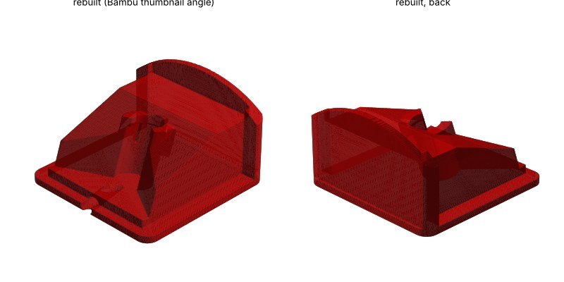

# PerchPi microphone hood (Clippy EM272)

A small 3D-printed hood that holds the Clippy EM272 microphone and shields it from rain and wind. It's the hood used on the developer's station.

| File | Use |
|---|---|
| `PerchPi_EM272_Hood_as-printed.3mf` | Open in Bambu Studio, PrusaSlicer or OrcaSlicer. |
| `PerchPi_EM272_Hood_as-printed.stl` | Any slicer. |

Size: 50 × 50 × 39 mm. Units are millimetres.

## Fitting it

1. Push the Clippy microphone into the holder. It's a tight fit, which keeps it in place.
2. Stick the hood to a window frame or another spot outdoors with **3M double-sided outdoor mounting tape**.

## Print settings (as printed)

- Material: **PETG** (handles sun and weather better than PLA)
- Layer height: 0.20 mm
- Walls: 2
- Infill: 15%
- Supports: none
- Brim: auto
- Orientation: as it opens in the slicer (flat base on the bed, curved lip on top)
- About 50 minutes and 17 g of filament on a Bambu Lab X1 Carbon

## About these files

The original design file isn't available. These files were rebuilt from the G-code of the printed part, so the curved lip shows faint 0.2 mm layer steps. It prints the same as the original.

Licence: CC BY-NC-SA 4.0, like the rest of PerchPi.
